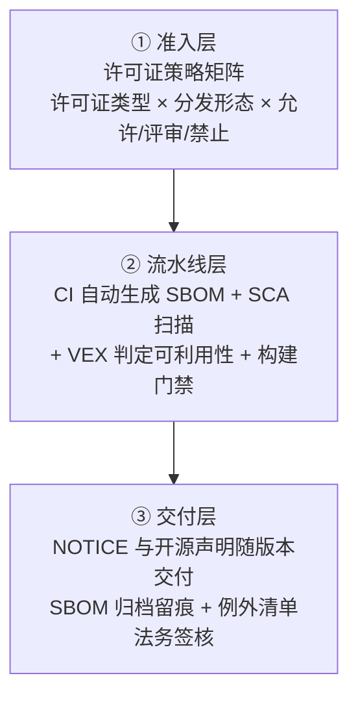

# 开源生态洞察与个人参与路径探讨

> 个人技术调研与工程实践报告 · 方向 A（商业与合规）
>   
> 作者：何毅 | 华东交通大学 软件工程

---

## 摘要

开源已是由许可证、治理与供应链共同构成的产业基础设施。本报告拆解宽松型（MIT、Apache 2.0）与强传染型（GPL、AGPL）许可证的商用差异，以 SBOM 为主线说明如何把合规改造成可自动化的工程流程，并基于"衍生作品 vs 聚合"的边界给出进程隔离策略。文末附四阶段成长计划与实操记录。

**关键词**：开源许可证；SBOM；GPL 传染性；进程隔离；开源合规治理

---

## 一、开源生态与商业/合规洞察

### 1.1 许可证的两个家族与商用差异

理解许可证只需抓住两个变量：**传染范围**（链接或修改后是否必须开源）与**触发条件**（什么动作才产生义务）。

| 许可证                    | 传染范围           | 闭源分发      | 专利明示授权            | 自建 SaaS      | 商业风险         |
| ---------------------- | -------------- | --------- | ----------------- | ------------ | ------------ |
| MIT / BSD-3-Clause     | 无              | ✅ 允许      | ❌ 无明示条款           | ✅ 允许         | 极低           |
| Apache-2.0             | 无              | ✅ 允许      | ✅ 授予 + 专利报复条款     | ✅ 允许         | 低（保留 NOTICE） |
| MPL-2.0                | 文件级            | ✅ 未改文件可闭源 | ✅                 | ✅            | 中低           |
| LGPL-2.1 / 3.0         | 库级             | ✅ 动态链接可闭源 | 仅 v3 有            | ✅            | 中            |
| GPL-2.0                | 强（进程级）         | ❌ 须开源衍生作品 | ❌ 无明示条款           | ✅ 未构成分发      | 高            |
| GPL-3.0                | 强              | ❌ 同上      | ✅ + 反 Tivoization | ✅ 未构成分发      | 高            |
| AGPL-3.0               | 强 + 网络条款 §13   | ❌         | ✅                 | ❌ 须向网络用户提供源码 | 极高           |
| SSPL / BUSL-1.1 / ELv2 | "源可用"，非 OSI 开源 | 受限        | —                 | 受限，禁做竞品托管    | 极高           |

三条最容易被工程团队误判的差异：

**一、Apache 2.0 与 MIT 的差别不在"自由"，而在专利。** MIT 只授予版权许可，对专利只字未提；Apache 2.0 明确授予贡献者的专利许可，并附加专利报复条款——你对该项目提起专利诉讼时，授权自动终止。对握有专利池的商业公司而言，这反而是保护。

**二、GPL 的义务由"分发"触发，这是个真实漏洞。** 自建服务器部署 GPL 软件、用户经浏览器访问，你没有"分发"软件本身，传染链路不会启动——这正是商业 SaaS 后端能安心使用 GPL 库的原因。AGPL v3 第 13 条专为补这个缺口而设：只要用户通过网络与修改后的程序交互，就必须提供对应源码，**AGPL 没有 SaaS 漏洞**。法务界的保守读法更严：把 AGPL 当作托管产品的红线，除非能证明仅以未修改的独立进程运行。

**三、许可证不是项目的静态属性。** Redis 多年 BSD 后于 2024 年 3 月改为 RSALv2/SSPL，引发 Linux 基金会托管 Valkey 分叉，随后又在 Redis 8（2025 年 5 月）切回 AGPLv3；HashiCorp 把 Terraform 切到 BUSL 1.1，直接催生 MPL-2.0 的 OpenTofu。到 2026 年主流发行版默认装的是 Valkey 而非 Redis——这不是功能竞争，而是"基金会治理的分叉无法被一家公司重新许可"的结构性优势。**教训：锁版本必须同时锁许可证版本，并归档每次发布的 SBOM 快照。**

### 1.2 SBOM：把合规从人治变成工程

SBOM（软件物料清单）是机器可读的软件成分清单，记录组件名、版本、唯一标识（PURL）、哈希、许可证与依赖关系，回答三个问题：发货的软件里究竟有什么？哪些组件中了新披露的 CVE？哪些组件的许可证不允许出现在当前分发形态里？

国际通行 **SPDX**（ISO/IEC 5962，偏重许可证）与 **CycloneDX**（偏重漏洞联动）；国内 **GB/T 47020-2026《网络安全技术 软件物料清单数据格式》** 已于 2026 年 8 月 1 日实施，统一了字段与文件后缀（`.SBOMDF.json`）。

落地归纳为"生成 → 扫描 → 门禁 → 交付"四步，且必须挂在 CI 上而非季度审计：

```yaml
# .github/workflows/supply-chain.yml（节选）
- name: License gate & SBOM
  run: |
    npx license-checker --production \
      --failOn 'GPL-2.0;GPL-3.0;AGPL-3.0;SSPL-1.0;BUSL-1.1'
    syft . -o cyclonedx-json=sbom.cdx.json      # 构建期生成
    grype sbom:sbom.cdx.json --fail-on high     # 用 SBOM 直接扫漏洞
    trivy fs . --scanners vuln,license --exit-code 1
```

法规正在提供强制动力。欧盟《网络弹性法案》（CRA，Regulation (EU) 2024/2847）2024 年 12 月 10 日生效：**漏洞与严重事件通报义务自 2026 年 9 月 11 日起适用**（24 小时预警、72 小时完整通报、14 天最终报告），含 SBOM 与 CE 标记的全面适用期为 2027 年 12 月 11 日，罚则最高 1500 万欧元或全球年营业额 2.5%。通报义务比 SBOM 义务早 15 个月——你无法通报一个从未盘点过的组件，SBOM 从 2026 年 9 月起已不可回避。国内《北京市开源生态体系建设实施方案（2026—2028 年）》同样要求推广 SBOM，引导财政资金采购的软件项目原则上包含 SBOM。

### 1.3 GPL 进程隔离：用架构换合规空间

GPL 的义务&#x7531;**"分发"**&#x4E0E;**"衍生作品"**&#x4E24;个要件共同触发；把两个独立程序放在一起分发属于**聚合（mere aggregation）**，不触发传染。这就是进程隔离策略的全部法律地基。按风险从低到高：

1. **独立进程 + 标准协议**：GPL 组件作为独立可执行文件运行，闭源主程序通过 REST / Socket / 管道通信，进程边界是最清晰的"非衍生作品"证据。
2. **命令行调用**：把 GPL 工具当 CLI 子进程使用，只交换文件与标准输入输出，不链接其内部符号。
3. **警惕动态链接**：动态链接通常仍被视为构成一个程序，LGPL 允许、GPL 不允许。
4. **警惕插件架构**：插件若与主程序共享内部数据结构、函数指针表，司法上很可能被认定为一个程序。
5. **严禁复制粘贴**：从 GPL 项目抄几行代码进闭源代码库是最经典的踩坑方式；SCA 全量扫描的意义正在于识别"清单上看不到的那部分"。
6. **AGPL 是例外**：其网络条款使"只提供服务不分发"的隔离思路失效，唯一安全姿势是原样、独立进程运行且不修改。

真实案例可校准预期：Artifex v. Hancom（2017）法院驳回被告动议，确认 GPL 具备可执行性，Hancom 最终和解；BusyBox 系列诉讼（2007—2009）证明违规代价是真金白银；Hellwig v. VMware（2024，德国汉堡法院驳回）说明"内核模块是否构成衍生作品"仍需个案举证。**隔离降低的是举证与赔付风险，不是免死金牌**，架构决策应写入 ADR 留痕。

### 1.4 企业常态化治理：三层防线



三层各解决一个问题：准入层把"该不该引入"从法务的 Word 文档变成工具里的规则；流水线层保证每次构建都说清成分；交付层让客户验收与出海认证从"十天"缩短为"十分钟"。

---


## 参考资料

1. EU Cyber Resilience Act，Regulation (EU) 2024/2847 及欧盟委员会 2026 年 7 月实施细则
2. 《北京市开源生态体系建设实施方案（2026—2028 年）》，北京市经济和信息化局，2026 年 5 月
3. GB/T 47020-2026《网络安全技术 软件物料清单数据格式》（2026-08-01 实施）
4. GB/T 44272-2024《信息技术 开源许可证框架》
5. OpenChain ISO/IEC 5230 开源许可证合规国际标准
6. SPDX（ISO/IEC 5962）与 CycloneDX 规范文档
7. Artifex Software, Inc. v. Hancom, Inc.，美国加州北区联邦地区法院，2017
8. Software Freedom Law Center v. Verizon 等 BusyBox 系列诉讼，2007—2009
9. Hellwig v. VMware，德国汉堡地区法院，2024 年裁定
10. Anchore Syft / Grype、Aqua Trivy、CISA SBOM 最小要素（2025 年征求意见稿）

---

*本报告为课程作业成果，采用 Apache-2.0 许可证发布，欢迎 issue 与 PR。*

